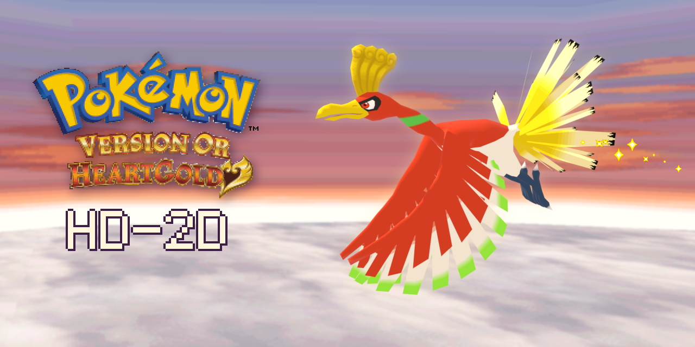
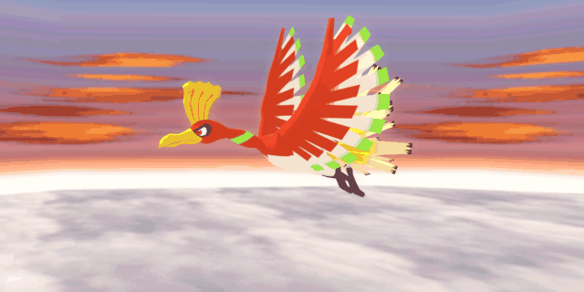

  

  
  
  
  
  

  <b>Your own copy of Pokémon HeartGold, replayed in HD-2D.</b> 
  The real Johto, with its maps, music, dialogue and animations, lit like Octopath Traveler.

  

<i>⭐ Star the repo to follow development and get notified of the first release.</i>

---

## What it is

HGSS HD-2D is an unofficial fan project that turns **your own** copy of Pokémon HeartGold into an HD-2D game:
3D terrain and buildings, characters and Pokémon as crisp pixel sprites, tilt-shift depth of field, soft light and long shadows.

Nothing is redrawn or invented. Every map, song, sound effect, line of dialogue and animation comes from **your** game,
read on **your** machine the first time you launch it. The HD-2D part is the lighting, the depth and the camera.

## Features

- 🗺️ **The real Johto in 3D**: every map from the original game, streamed around you as you walk.
- 🌿 **Pokémon you can see**: wild Pokémon roam the tall grass with their own walking sprites; touch one to start a battle.
- ⚔️ **HeartGold battles**: the original generation IV rules, moves and trainers, with a quicker pace.
- 🎵 **Original music and sound**: the game's own soundtrack and effects, from your cartridge.
- 🌊 **Original animations**: sea, shore waves and flowers move exactly like on the DS.
- 🤝 **Co-op**: explore Johto with a friend; one player hosts, the other joins.
- 💾 **Everything you expect**: Pokédex, party, bag, PC boxes, Poké Marts, trainers, saving.

## What you need

- **Your own copy of Pokémon HeartGold (French version)**, as a ROM file made from your own cartridge.
- A Mac with Apple Silicon (M1 or later) for now. Windows and Linux are planned.

That's it: no Python, no emulator, no extra download. On first launch, pick your ROM (or drop it on the app icon);
the game prepares its files once, in about a minute, and starts.

**No ROM, game file, image or sound from Nintendo is distributed here, and none ever will be.**
ROM requests are deleted.

## Roadmap

| Version | Content | Status |
|---|---|---|
| **v0.1** | New Bark Town → first Gym badge, solo or 2-player co-op, macOS | 🛠️ in progress |
| v0.2 | Windows and Linux builds | planned |
| later | The rest of Johto, up to 4 players, day/night | planned |

## FAQ

**Is the source code available?** No. Builds are shared through [Releases](../../releases); the code stays private.

**Why do I need my own ROM?** So that nothing copyrighted is ever shipped. The game reads your copy locally and never sends it anywhere.

**Which version of the game?** The French HeartGold ROM for now. Other languages and SoulSilver may come later.

**macOS says the app can't be opened.** The app isn't notarized by Apple yet: right-click it and choose **Open** the first time.

**I found a bug.** Open an [issue](../../issues/new/choose) with what you did and what you saw. No ROMs or game files in issues, please.

<b>🇫🇷 En français</b>

### Qu'est-ce que c'est

HGSS HD-2D est un projet de fan non officiel qui transforme **ta propre** copie de Pokémon HeartGold en jeu HD-2D : décors et
bâtiments en 3D, personnages et Pokémon en sprites pixel nets, profondeur de champ façon maquette, lumière douce et ombres longues.

Rien n'est redessiné ni inventé : cartes, musiques, bruitages, dialogues et animations viennent de **ton** jeu, lu sur **ta** machine
au premier lancement. Le HD-2D, c'est la lumière, la profondeur et la caméra.

### Ce qu'il faut

- **Ta propre copie de Pokémon HeartGold (version française)**, en fichier ROM tiré de ta propre cartouche.
- Un Mac Apple Silicon (M1 ou plus récent) pour l'instant ; Windows et Linux sont prévus.

Au premier lancement, choisis ta ROM (ou dépose-la sur l'icône) : le jeu prépare ses fichiers une seule fois, en une minute environ.

**Aucune ROM, aucun fichier, aucune image ni aucun son de Nintendo n'est distribué ici, ni ne le sera.** Les demandes de ROM sont supprimées.

### Feuille de route

v0.1 (en cours) : de Bourg Geon au premier badge, en solo ou à deux, sur macOS. Ensuite : Windows et Linux, puis le reste de Johto.

⭐ Mets une étoile au dépôt pour suivre le projet et être prévenu de la première version.

## Disclaimer

Unofficial, non-commercial fan project. Not affiliated with or endorsed by Nintendo, Game Freak, Creatures Inc. or The Pokémon Company.
Pokémon and all related names are trademarks of their respective owners. No ROM or copyrighted game data is distributed.
Rights holders can reach out through an issue; any request will be handled promptly.

*Projet de fan non officiel et non commercial, ni affilié à Nintendo, Game Freak, Creatures Inc. ou The Pokémon Company, ni approuvé par eux.
Les ayants droit peuvent me contacter via une issue : toute demande sera traitée rapidement.*
